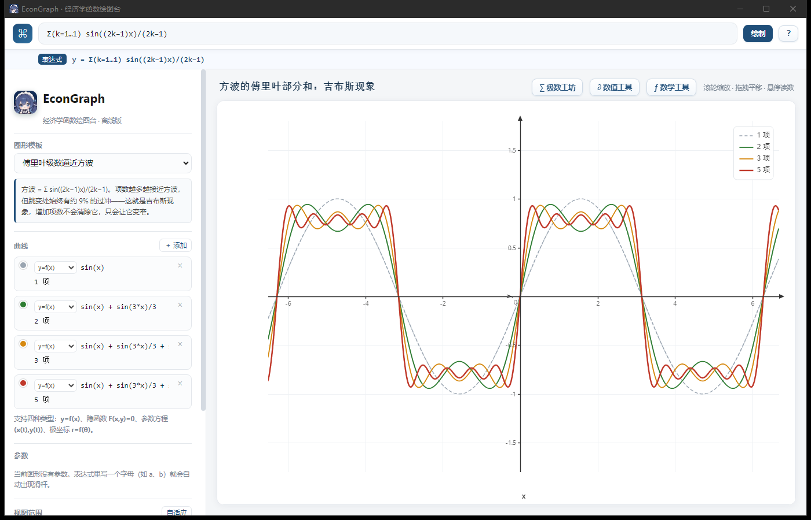
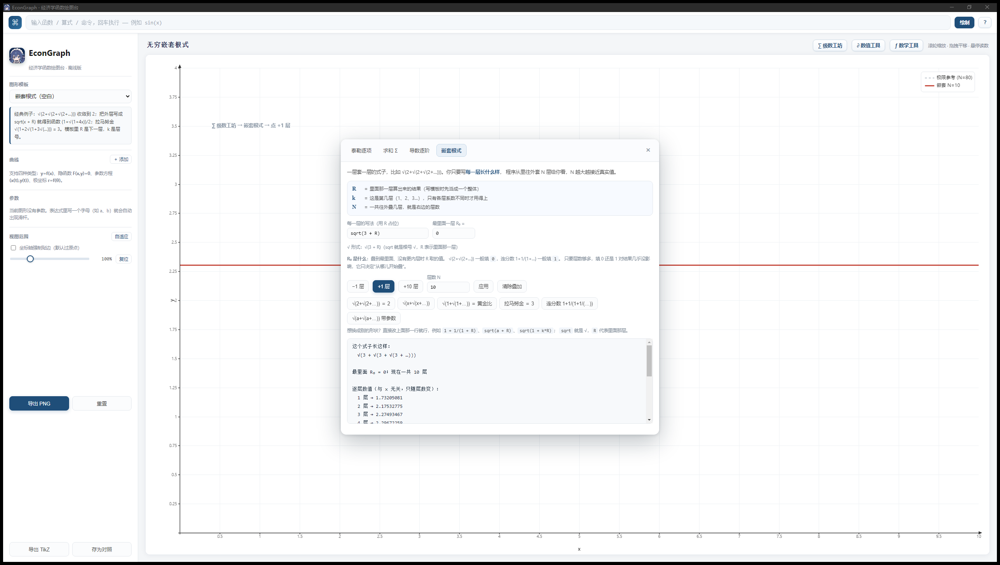
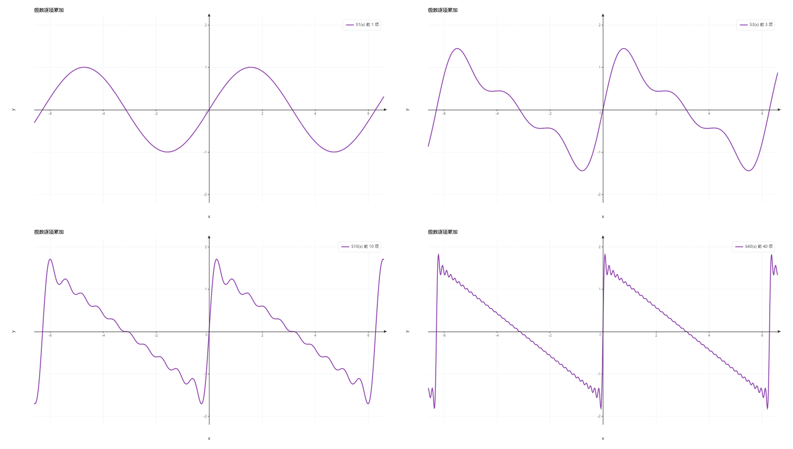

# 小肥鱼的函数小屋 · EconGraph


> 一个面向高中生和大学生的**简陋**函数绘图中文软件 —— 但支持**用中文描述函数**。
> 如果可以，十分欢迎且恳求每一位喜欢数学，喜欢经济学，金融学，深深喜爱函数变换过程，或者是有相应的教学需求的用户多多参与，加入到改进，完善这一bug频出，十分简陋的函数小屋中！
> 以下是它的特点讲解！

[](https://moumoujiuzi.github.io/econgraph/) [](LICENSE) [](../../releases)

输入 `x的平方加sinx的立方`，它认识：
`y = x² + sin(x)³`。



---

## 这是什么

一个用原生 HTML/CSS/JS 写的 2D 函数绘图工具，可以直接在浏览器打开，
也可以打包成 Windows 桌面程序（Electron，离线、免安装）。

写它的初衷很简单：**数学软件的命令行太反人类，而一些严谨的函数网站操作门槛又过高。**
所以这里的输入框，你想到什么就写什么：

| 你写 | 它画 |
|---|---|
| `sin(x)` | 正弦 |
| `x的平方加sinx的立方` | `x² + sin(x)³` |
| `五分之三` | `3/5` |
| `根号x加三` | `√x + 3` |
| `e的x分之一次方` | `e^(1/x)` |
| `x^2 + y^2 = 4` | 圆（隐函数） |
| `(cos(t), sin(t))` | 参数曲线 |
| `33的6次方` | 直接算出来，并画一条参考线 |

---

## 功能

### 四种曲线
`y = f(x)` 显函数、`F(x,y) = 0` 隐函数（marching squares）、参数曲线、极坐标。

### 25+ 模板
按 **经济学 / 金融 / 数学 / 动态** 分类，一键切换，参数用滑杆实时调：

- **经济学**：凯恩斯消费函数、供需与价格上限、无差异曲线、成本曲线、IS–LM、AD–AS、索洛模型、等产量线、古诺均衡、洛伦兹曲线
- **金融**：期权到期收益、SML 证券市场线、债券价格
- **数学**：魏尔斯特拉斯病态函数、高次多项式、高阶导数、泰勒展开、傅里叶级数
- **动态**：Lotka–Volterra、SIR 传染病、鞍点、稳定焦点、IS–LM 调整动态

### ∑ 级数工坊
四张可以「点一下长一项」的工作台：

- **泰勒逐项**：每点一次 `+1 阶` 多一项，实时画出新的部分和；在 x₀ 处自动检测左右导数，不相等会提示"不可导"
- **求和 Σ**：左边一个标准求和符号，上面填上限、下面填起始，右边填通项——**不用会打 Σ**
- **导数逐阶**：点一次多画一阶导，每阶一种颜色
- **嵌套根式**：√(2+√(2+…)) 这类无穷嵌套，显示展开式和逐层数值



### 顶部命令栏
窗口最上方输入，回车即画：

```
sin(x)                      直接画
2 + 3*4                     算出来 = 14，画参考线
x^2 + y^2 = 4               隐函数
add(sin(x), x^2)            画 f、g 和 f+g 三条
taylor(sin(x), 7)           7 阶泰勒多项式
series(sin(n*x)/n, 40)      级数前 40 项
deriv(sin(x), 3)            0–3 阶导
preset(islm)                切换模板
```

**边打边画**：输入到哪画到哪，写到一半（比如 `x^2+sin`）会保留上一段完整表达式，不会把图清空。

### 数学工具
求根、切线、定积分、黎曼和、迭代蛛网、最小二乘拟合、二项式展开、莱布尼茨公式、数值导数、TikZ 导出。（ps：我真的很喜欢牛爵爷和莱布尼茨这些伟大数学家科学家的科学发展史！在此鸣谢长河劫up！）



---

## 怎么用

### 方式一：下载即用（推荐给同学）

到 [Releases](../../releases) 下载：

- `EconGraph-web.html` —— **单个 HTML 文件**，双击用浏览器打开，零安装
- `EconGraph-portable.zip` —— 解压后双击 `EconGraph.exe`，独立窗口，完全离线

### 方式二：从源码运行

```bash
git clone https://github.com/moumoujiuzi/econgraph.git
cd econgraph
```

浏览器直接打开 `index.html` 即可（纯静态，无需服务器）。

想要桌面窗口：

```bash
npm install
npm start
```

### 方式三：自己打包 exe

```powershell
# 需要 Windows + .NET Framework 4.x 自带的 csc.exe
powershell -ExecutionPolicy Bypass -File build\build_win.ps1
```

---

## 一些实现说明

| 模块 | 做法 |
|---|---|
| 表达式解析 | 手写递归下降，支持隐式乘法、参数、`Σ`/`√`/`π`/`∞` 等符号 |
| 中文输入 | 规范化层：中文数字、`A分之B`、`X的N次方`、全角字符 → 标准 ASCII |
| 隐函数 | marching squares 等值线 |
| 数值 | 二分/牛顿求根、Simpson 积分、RK4、2×2 特征值判稳 |
| 符号 | 求导、泰勒、二项式、莱布尼茨（AST 上直接变换） |
| 渲染 | Canvas 2D，按像素列多重采样 + 振荡包络，防止高频函数被画成假直线 |
| 中文排版 | 坐标轴、标注、图例都用系统中文字体 |

### 已知限制

- 只做 2D，没有 3D 曲面
- 符号求导不支持 `floor`、`min/max` 等
- 隐函数在极点附近由网格精度决定，不是解析解
- 高频函数放大到波长小于 2 像素后，画出来的是**包络带**而不是单个波峰——这是采样定理的限制，不是 bug

---

## 测试

```bash
npm test
```

覆盖：表达式解析 27 项、符号计算 42 项、数值工具 22 项、动态系统 21 项、中文规范化 27 项。

---

## 目录结构

```
.
├─ index.html            入口
├─ styles.css            样式
├─ js/
│  ├─ mathfn.js          表达式解析与求值
│  ├─ normalize.js       中文/符号规范化
│  ├─ calculus.js        符号求导、泰勒、二项式、莱布尼茨
│  ├─ numeric.js         求根、积分、黎曼和、OLSE、CSV
│  ├─ dynsys.js          2D 动力系统：RK4、雅可比、特征值、平衡点
│  ├─ plot.js            Canvas 渲染器
│  ├─ presets*.js        模板
│  ├─ tools.js           数学/数值工具面板
│  ├─ series.js          级数工坊
│  ├─ cmdbar.js          顶部命令栏
│  ├─ web-shim.js        浏览器环境下的保存接口
│  └─ app.js             主逻辑
├─ desktop/              Electron 主进程与预加载
├─ build/                打包脚本（Windows / 单文件 HTML）
├─ tests/                Node 单元测试
└─ docs/                 截图
```

---

## 参与贡献

**任何 GitHub 用户都可以获取、修改、再发布这个项目**，只要保留 MIT 协议和版权声明。

| 你想做什么 | 怎么做 |
|---|---|
| 拿来用 / 改着玩 | `git clone` 或直接下载 ZIP，不用问任何人 |
| 提改进 | Fork → 改 → 发 Pull Request，我合并 |
| 报问题 | 开 Issue，写清楚「输入了什么、期望什么、实际什么」 |
| 发给别人 | 随便发，MIT 不限商用（第三方图像除外） |

`main` 分支似乎只有作者能直接推送，其他人通过 **Fork + Pull Request** 参与


---

## 图标

<p align="center">
  
</p>

> **这是一个看起来更正式，更严肃的图标，由作者自己设置和选取。**

蓝底白 Σ（也像大写字母 E）—— 程序、安装包、网页版用的都是它，源文件见
[`assets/icon-formal.png`](assets/icon-formal.png) 与 [`assets/icon-formal.ico`](assets/icon-formal.ico)。

早期的小肥鱼形象（`assets/icon.png`）来自网络，仅作彩蛋保留。

---

## 许可

[MIT](LICENSE) —— 随便用、随便改，注明出处即可。

代码以 MIT 发布；正式图标（Σ）由作者自选并提供；早期小肥鱼形象来自网络（侵权则删）。

## 致谢

- 灵感来自曼昆《宏观经济学》里的那些图，以及各种"画不出图"的数学课
- 用到的技术：Canvas 2D、Electron、.NET Framework


